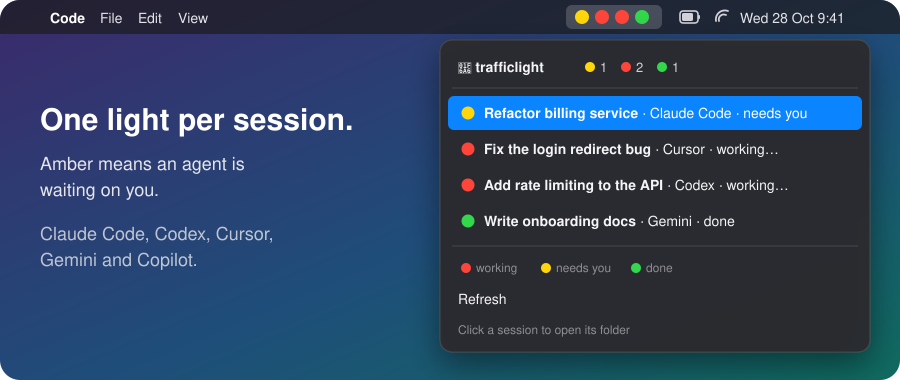

<p align="center">
  
</p>

<p align="center">
  🔴 <b>working</b> &nbsp;·&nbsp; 🟡 <b>needs you</b> &nbsp;·&nbsp; 🟢 <b>done</b>
</p>

Running a few AI coding agents at once and can't tell which one is stuck on a permission prompt? 🚦 **trafficlight** puts one light per session in your macOS menu bar, so you can see at a glance who's busy, who's waiting on you, and who's finished.

It works with **Claude Code, Codex, Gemini CLI, Cursor and GitHub Copilot**.

<p align="center">
  
</p>

## 🚥 What the lights mean

| Light | State | Turns on when |
|:---:|---|---|
| 🔴 | **Working** | You send a prompt, or a tool finishes and the agent keeps going |
| 🟡 | **Needs you** | The agent is waiting for your approval or an answer |
| 🟢 | **Done** | The turn finished, or you interrupted it |
| ⚫️ | **Stopped on an error** | The turn ended on an error (rate limit, billing, ...) |
| 🚦 | **No sessions** | Nothing running. Go touch grass. |

Amber sorts first, so the session that's blocked on you is always the leftmost light. Click the menu for each session's title, agent, state and how long ago it changed; click a session to open its folder.

## 🤖 Supported agents

| Agent | 🔴 | 🟡 | 🟢 | ⚫️ | Hooks go in |
|---|:---:|:---:|:---:|:---:|---|
| Claude Code | ✅ | ✅ | ✅ | ✅ | `~/.claude/settings.json` |
| Codex CLI | ✅ | ✅ | ✅ | | `~/.codex/hooks.json` |
| Gemini CLI | ✅ | ✅ | ✅ | | `~/.gemini/settings.json` |
| Cursor | ✅ | | ✅ | ✅ | `~/.cursor/hooks.json` |
| GitHub Copilot (VS Code) | ✅ | | ✅ | | `~/.copilot/hooks/trafficlight.json` |

Cursor and Copilot don't expose an event for "waiting on your approval", so they show red and green only.

## 🏁 Install

```bash
brew install --cask swiftbar
brew install samhudson/tap/trafficlight
trafficlight install
```

`install` finds the agents on your Mac and wires up each one. To pick them yourself: `trafficlight install claude cursor`. Restart running agent sessions so they load the hooks. Green light. 🟢

Optional: start SwiftBar at login (and bring it back if it crashes):

```bash
brew services start trafficlight
```

## 🛠 Commands

```bash
trafficlight install [agent...]     # wire up detected agents, or the ones named
trafficlight status                 # which agents are wired up, plugin, SwiftBar
trafficlight uninstall [agent...]   # remove hooks (everything if no agent named)
```

Agents: `claude`, `codex`, `gemini`, `cursor`, `copilot`.

## ⚙️ How it works

- **Hooks.** Each agent calls one small script, `trafficlight-hook <agent> <event>`, at points like prompt submitted, tool finished, approval needed and turn stopped. It writes the session's state to `~/.trafficlight/sessions/` and pings SwiftBar only when the colour changes.
- **Only real blockers go amber.** Informational notifications (idle reminders, login success, quota notices, ...) are ignored.
- **Plugin.** `trafficlight.5s.sh` renders one light per session and drops sessions that ended or went quiet for 12 hours. For Claude Code it also reads Claude's own session list, so it notices interrupted turns and sessions started before you installed.
- **Sessions are named like your tabs.** Claude Code sessions use Claude's own title (the one in your editor tab and `/resume`, or your rename). Other agents use the first line of the session's first prompt. With no title yet, the folder name is shown, with the parent when two share a name (`acme/api` vs `demo/api`). Hover a session for its full folder path.
- **Safe to add and remove.** `install` backs up each config file (`*.bak.trafficlight`) and leaves your other hooks alone. Hook commands are guarded, so uninstalling the formula first never causes hook errors.

## 🧪 Tests

```bash
./test/run.sh
```

80+ checks covering every agent's state transitions, the plugin rendering, and the installer's edits to each config file, all in a throwaway `$HOME`.

## Requirements

macOS, [SwiftBar](https://swiftbar.app), `jq`, and at least one supported agent.

## License

MIT
